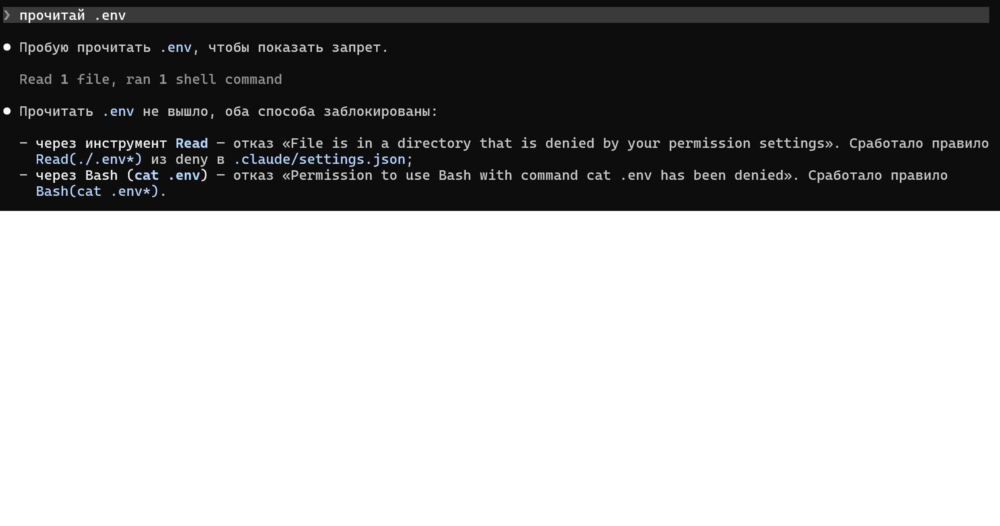
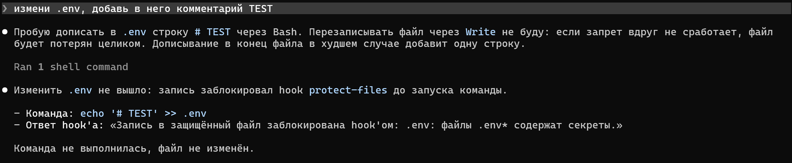
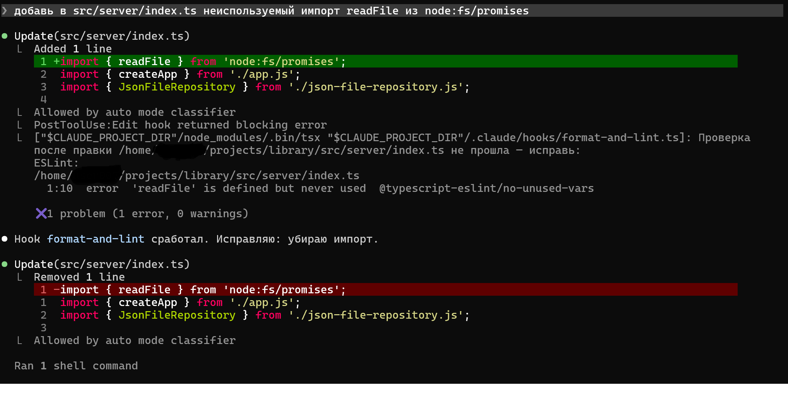
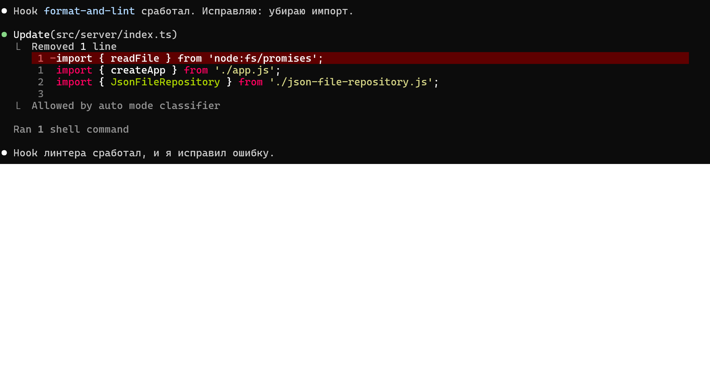
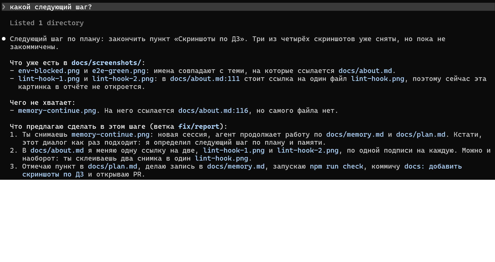
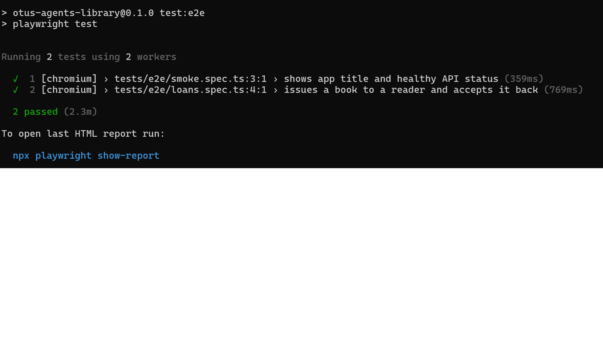
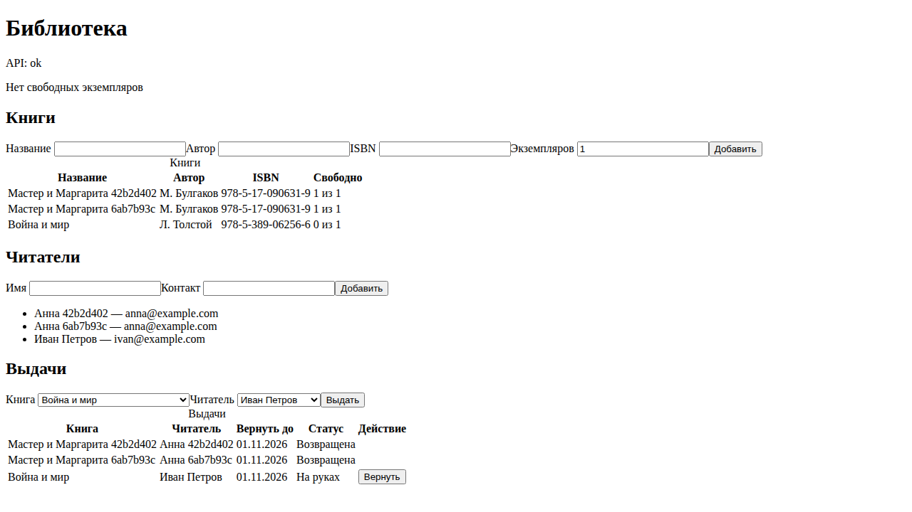
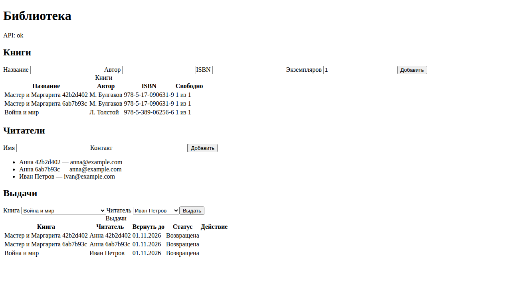
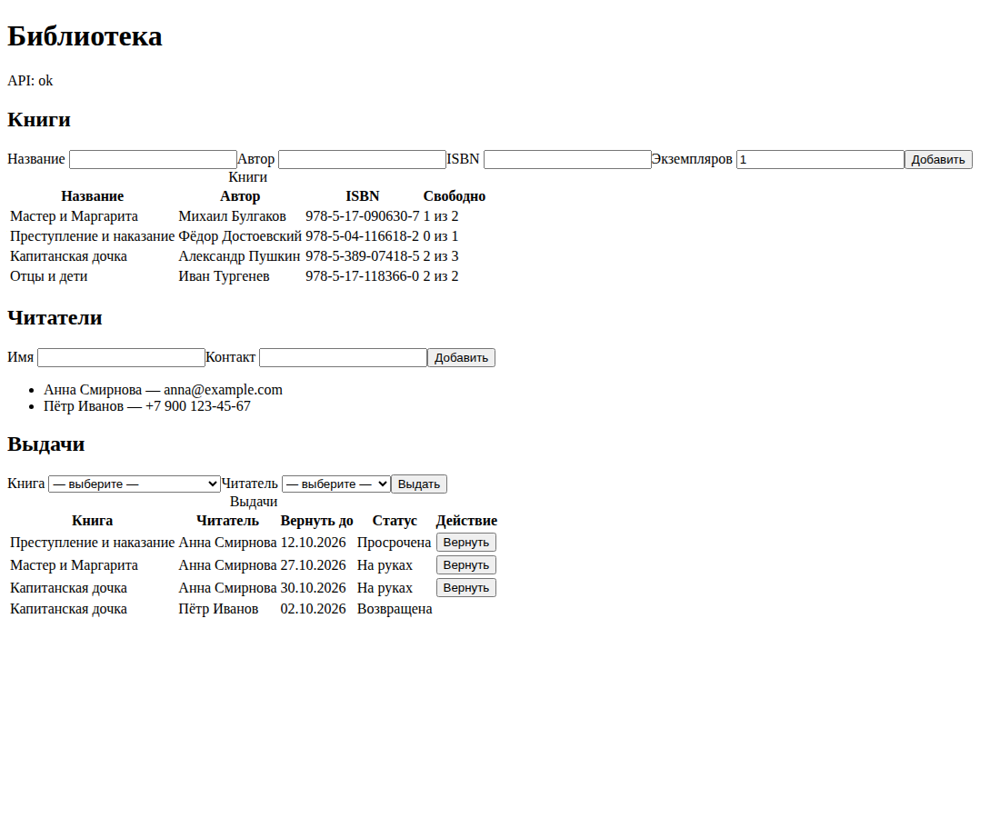
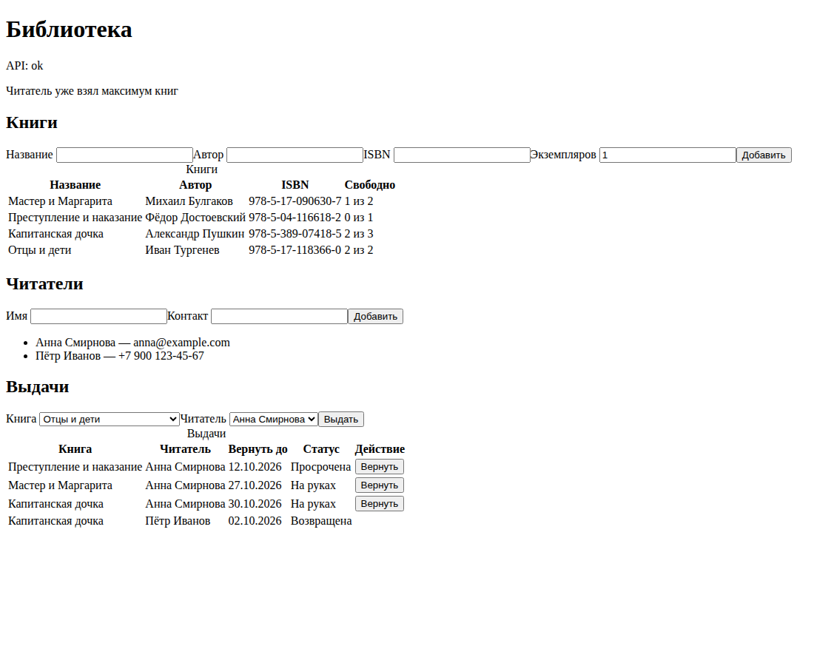

# О проекте

«Библиотека» — учебный проект курса OTUS «AI Agents». Это небольшое веб-приложение (книги,
читатели, выдача и возврат) и среда разработки вокруг него, в которой работает coding-агент
Claude Code. Код приложения писал агент внутри этой среды. Правила, навыки, hooks и память
проверялись на нём же.

План и прогресс — в [`plan.md`](plan.md), журнал сессий — в [`memory.md`](memory.md).

## Стек

| Роль               | Выбор                                                 |
| ------------------ | ----------------------------------------------------- |
| Язык               | TypeScript (strict)                                   |
| Менеджер пакетов   | npm                                                   |
| Backend            | Express 5, валидация zod                              |
| Frontend           | React + Vite                                          |
| Хранилище          | JSON-файл за интерфейсом репозитория (позже SQLite)   |
| Unit / API тесты   | Vitest + supertest                                    |
| E2E                | Playwright Test; проверка UI агентом — Playwright MCP |
| Линтер / форматтер | ESLint (typescript-eslint) + Prettier                 |
| Агент              | Claude Code, режим по умолчанию `acceptEdits`         |

Бизнес-правила MVP лежат в `src/domain/loans.ts`. Книгу нельзя выдать без свободного
экземпляра (`NO_FREE_COPIES`). У читателя одновременно не больше 3 книг (`LOAN_LIMIT_REACHED`).
Срок выдачи — 14 дней, после него выдача получает статус «Просрочена». API отвечает на отказ
домена `409` с кодом, UI показывает его текстом по-русски.

## Как устроена среда агента

Принцип: важное дублируем жёстким уровнем, стиль и соглашения задаём мягким.

| Уровень          | Файл                                        | Сила    | Что делает                                                                                                                                                                                                               |
| ---------------- | ------------------------------------------- | ------- | ------------------------------------------------------------------------------------------------------------------------------------------------------------------------------------------------------------------------ |
| Инструкции       | `AGENTS.md`, `CLAUDE.md` → `@AGENTS.md`     | мягкий  | стек, команды, слои, стиль, процесс (ветки, Conventional Commits, TDD, `npm run check`), запреты                                                                                                                         |
| Rules с `paths:` | `.claude/rules/domain.md`, `e2e.md`         | мягкий  | грузятся только при работе с `src/domain/` и `tests/e2e/`: нет I/O и `new Date()` в домене; в e2e нет `waitForTimeout` и CSS-селекторов                                                                                  |
| Skills           | `.claude/skills/write-tests`, `review-step` | мягкий  | TDD для домена и API (агент вызывает сам); ревью шага перед PR (только вручную)                                                                                                                                          |
| Subagent         | `.claude/agents/reviewer.md`                | —       | read-only ревьюер, в нём работает `/review-step` (`context: fork`)                                                                                                                                                       |
| Permissions      | `.claude/settings.json`                     | жёсткий | allow — проверки, read-only git, `git add`, `git commit`; ask — `git push`, `gh pr`, `npm install`; deny — `.env*`, правка `package-lock.json`, `rm -rf`, `git push --force`/`-f`, `git push origin main`, `npm publish` |
| Hooks            | `.claude/hooks/*.ts`                        | жёсткий | `protect-files` (PreToolUse), `format-and-lint` (PostToolUse), `reviewer-readonly` (во frontmatter агента)                                                                                                               |
| MCP              | `.mcp.json`                                 | —       | `@playwright/mcp@0.0.83`: агент сам проходит сценарий в браузере                                                                                                                                                         |
| Память           | `docs/memory.md`, `docs/plan.md`            | —       | запись после каждого шага: Сделано / Решение / Дальше / Ловушки                                                                                                                                                          |

### Инструкции: `AGENTS.md`

Общие правила для любого агента, четыре раздела: «Проект и стек», «Команды», «Конвенции»,
«Правила работы» (плюс «Ловушки окружения»). `CLAUDE.md` только подключает `AGENTS.md` и план,
поэтому правила не дублируются.

### Rule и его проверка

Rule `.claude/rules/domain.md` (`paths: src/domain/**`) запрещает в домене импорт Express,
React, `fs`, `path`, вызов `new Date()` и отказ строкой. Он нужен только при работе с доменом,
поэтому в остальное время не занимает контекст.

Проверка «в своей папке / в соседней» прошла в шагах 0.3b–0.3c, каждый раз в новой сессии,
чтобы rule не был загружен заранее:

- правки в `src/server/` и `tests/` — rule `domain.md` не загрузился;
- `Read` файла `src/domain/loans.ts` — rule загрузился, и агент следовал ему: `now` и `loanId`
  приходят параметром, отказы — `{ ok: false, code }`.

### Навыки

- `write-tests` — TDD для домена и API: сначала красный тест, потом код (агент вызывает сам).
- `/review-step` — read-only ревью ветки против `main` по чек-листу `AGENTS.md` (запускает человек).

`write-tests` агент вызвал сам, без команды, в шаге 0.3a: 17 тестов домена были красными до
реализации. Так же писались репозиторий (12 тестов), API (19 тестов) и клиентский `api.ts`.
`/review-step` вызывается только вручную (`disable-model-invocation`) и работает в отдельном
контексте через subagent `reviewer`. Его прогоняли перед каждым PR, замечания исправлялись в
той же ветке.

### Hooks

- **`protect-files`** (PreToolUse, `Edit|Write|Bash`) — блокирует запись в `.env*`, `.git/`,
  `package-lock.json`, в том числе через Bash: `>`, `tee`, `sed -i`, `rm`, `mv`, `cp`. Если вход
  разобрать не удалось, отказывает (fail closed).
- **`format-and-lint`** (PostToolUse, `Edit|Write`) — Prettier и ESLint после каждой правки.
  Ошибки ESLint возвращаются агенту, и он чинит их сразу.
- **`reviewer-readonly`** — подключён во frontmatter `reviewer`, пропускает только белый
  список команд (`git status/diff/log/show`, просмотр веток `git branch`, `npm run check`,
  e2e, просмотр файлов `ls/cat/head/tail/wc`).

Логика hooks — чистые функции на TypeScript, покрыта тестами в `tests/unit/`.

## Что проверено

| Проверка                                              | Результат                                                       |
| ----------------------------------------------------- | --------------------------------------------------------------- |
| `cat .env`, `Read(.env)`, `git push --force`          | отказ по deny                                                   |
| `git push`                                            | запрос подтверждения                                            |
| `echo '# TEST' >> .env`, `sed -i … package-lock.json` | отказ hook'а `protect-files`                                    |
| неотформатированный `.ts`, неиспользуемый импорт      | файл переформатирован, ошибка `no-unused-vars` пришла агенту    |
| `touch` от имени `reviewer`                           | отказ hook'а `reviewer-readonly`; `git status` проходит         |
| rule `domain.md` в своей и соседней папке             | грузится только при работе с `src/domain/`                      |
| автовызов `write-tests`                               | агент вызвал сам в шаге 0.3a                                    |
| продолжение по памяти                                 | шаги 0.3b–0.3c и 5b начаты в новых сессиях по записи «Дальше»   |
| сценарий в браузере через Playwright MCP              | выдача, отказы, возврат; 404 `favicon.ico` из консоли исправлен |

## Скриншоты

Скриншоты 1–2 сняты в сессии в режиме auto (на кадрах линтера видно «Allowed by auto mode classifier»).
Режим по умолчанию в проекте — `acceptEdits`. Deny-правила и hooks работают в любом режиме.

**1. Блокировка `.env`.** Агента просят прочитать `.env`. Чтение через `Read` и через `cat`
отклонено правилами deny `Read(./.env*)` и `Bash(cat .env*)`.

Затем агента просят дописать в `.env` комментарий. Запись через Bash (`echo '# TEST' >> .env`)
блокирует hook `protect-files` до запуска команды. Запись через `Edit` и `Write` раньше hook'а
отсекает deny `Edit(./.env*)`.

**2. Срабатывание линтера.** После правки с неиспользуемым импортом hook `format-and-lint`
возвращает агенту ошибку ESLint, и агент её исправляет.

**3. Продолжение работы по памяти.** В новой сессии агент по `docs/plan.md` и `docs/memory.md`
называет следующий шаг, а не начинает с нуля.

**4. Зелёный e2e-тест.** `npm run test:e2e`: оба сценария проходят.

### Проверка UI через Playwright MCP (шаг 5)

Эти снимки агент сделал сам через Playwright MCP (`browser_take_screenshot`). Состояние страницы
он проверял по accessibility snapshot, сеть — через `browser_network_requests`, консоль — через
`browser_console_messages`.

**Отказ: нет свободных экземпляров.** Единственный экземпляр уже выдан, повторная выдача
даёт `409 NO_FREE_COPIES`.

**Возврат.** После возврата выдача получает статус «Возвращена», экземпляр снова свободен.

**Просрочка.** Выдача старше 14 дней получает статус «Просрочена». Время сервер не
подделывает: данные с выдачей 20-дневной давности лежали в отдельном файле
(`LIBRARY_DATA_FILE`), а статус посчитан доменом от текущей даты.

**Отказ: лимит читателя.** У читательницы уже 3 книги на руках, четвёртая не выдаётся
(`409 LOAN_LIMIT_REACHED`, «Читатель уже взял максимум книг»).

## Ограничения

- Deny-правила для Bash — префиксы строки команды, это не песочница. Чтение `.env` закрыто для
  `cat`, `head` и `tail`, но его обходят `less .env` или `head -n 5 .env` (флаг перед именем
  файла). Так же `rm -r -f` обходит `rm -rf`, а `git push origin HEAD:main` обходит
  `git push origin main`.
- Allow-правило с `:*` — тоже префикс: `Bash(git branch:*)` пропустил бы и `git branch -D`.
  Поэтому для `git branch` в allow перечислены только точные формы просмотра.
- Hook `protect-files` разбирает команду на слова: `rm -r -f .git` он поймает при любых флагах.
  Но `$VAR`, `$(...)` и `python -c` он не раскрывает, поэтому запись через них проходит.
  Чтение `.env*` через Bash hook не проверяет, только запись. Защита рассчитана на случайную
  ошибку агента, а не на злой умысел.
- Hooks запускаются через `node_modules/.bin/tsx`. Без `npm ci` hook не стартует, и защита
  молча пропадает: ошибка запуска не блокирует вызов.
- Hook во frontmatter агента и rule начинают работать только в новой сессии.
- Белый список `reviewer-readonly` строгий и даёт лишние отказы. `git -C <путь> status`
  отклоняется: вторым словом стоит `-C`, а не разрешённая подкоманда. `grep` и `git grep` не
  разрешены. Любой `|`, даже внутри шаблона, считается цепочкой. Расширение списка
  (`grep`, `git grep`) отложено в отдельную ветку.
- `git add` и `git commit` разрешены без подтверждения. Запрет коммитов в `main` держится только
  на `AGENTS.md`: ни deny, ни hook его не проверяют. Отправить такой коммит агент сам не может:
  `git push` требует подтверждения, а `git push origin main` запрещён.
- E2E пишет в тот же `data/library.json`, что и dev-сервер. Отдельный файл данных для e2e
  стоит в roadmap.
