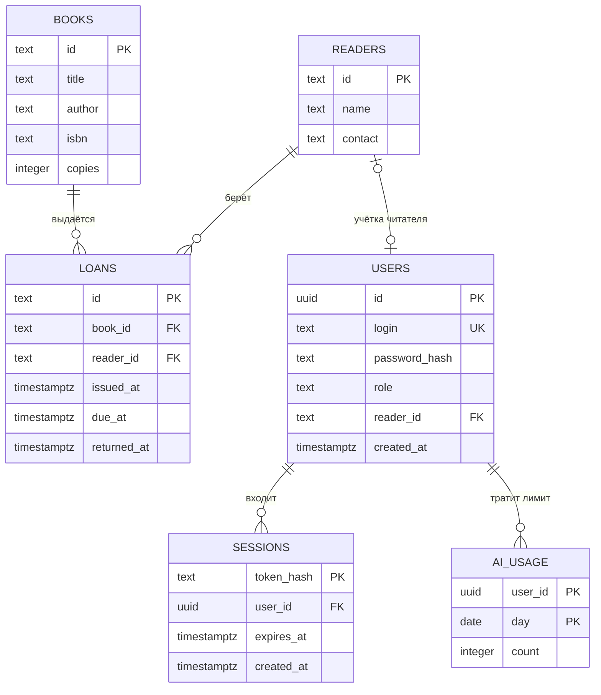

# Архитектура среды агента

Документ описывает среду, в которой агент (Claude Code) разрабатывает проект: какие файлы им
управляют, в каком порядке они срабатывают и где лежат доказательства работы. Архитектура самого
приложения (слои `domain` → `server` → `client`, репозиторий, API) описана отдельно —
[`.planning/codebase/ARCHITECTURE.md`](../.planning/codebase/ARCHITECTURE.md).

Принцип прежний, из ДЗ-1 ([`docs/about.md`](about.md)): важное держит жёсткий уровень
(permissions, hooks, тесты), стиль и процесс задаёт мягкий (инструкции, rules, skills).

## Слои

```text
┌──────────────────────────────────────────────────────────────────────────────┐
│ 1. Инструкции   CLAUDE.md → @AGENTS.md, @.planning/STATE.md                  │
│                 .claude/rules/*.md (по paths:), .claude/skills/*/SKILL.md    │
├──────────────────────────────────────────────────────────────────────────────┤
│ 2. Планирование GSD Core 1.18.0: .planning/ROADMAP.md, REQUIREMENTS.md,      │
│                 STATE.md, phases/<NN>-*/ (SPEC, CONTEXT, PLAN, VERIFICATION)  │
├──────────────────────────────────────────────────────────────────────────────┤
│ 3. Память       claude-mem (вне git) │ auto memory (вне git) │ docs/memory.md │
├──────────────────────────────────────────────────────────────────────────────┤
│ 4. Hooks        SessionStart · PreCompact · PreToolUse · PostToolUse         │
│                 .claude/hooks/*.ts, регистрация в .claude/settings.json       │
├──────────────────────────────────────────────────────────────────────────────┤
│ 5. Контекст     autoCompactWindow 200k · чек-пойнт · statusline · монитор     │
└──────────────────────────────────────────────────────────────────────────────┘
  Сквозное: permissions в .claude/settings.json и security-checklist
```

### 1. Инструкции

| Файл                                                                                         | Когда грузится                           | Что задаёт                                                                                           |
| -------------------------------------------------------------------------------------------- | ---------------------------------------- | ---------------------------------------------------------------------------------------------------- |
| [`CLAUDE.md`](../CLAUDE.md)                                                                  | каждая сессия                            | только импорты: `@AGENTS.md` и `@.planning/STATE.md`                                                 |
| [`AGENTS.md`](../AGENTS.md)                                                                  | через `CLAUDE.md`                        | стек, команды, слои, стиль, процесс, запреты, политика контекста, ловушки                            |
| [`.claude/rules/domain.md`](../.claude/rules/domain.md), [`e2e.md`](../.claude/rules/e2e.md) | при работе с `src/domain/`, `tests/e2e/` | чистота домена; правила e2e                                                                          |
| [`.claude/skills/`](../.claude/skills/)                                                      | по описанию или явному вызову            | `write-tests`, `review-step`, быстрые команды `lib-check`, `lib-status`, `lib-handoff`, `lib-commit` |
| [`.claude/agents/reviewer.md`](../.claude/agents/reviewer.md)                                | в `/review-step`                         | read-only ревьюер в отдельном контексте                                                              |

Правила пишутся один раз в `AGENTS.md`, чтобы ими мог пользоваться любой агент. В `CLAUDE.md` правил нет.
Позиция в плане приходит в каждую сессию вместе с `STATE.md`, поэтому агенту не нужно её искать.

Быстрые команды `/lib-*` — это skills с префиксом `lib-`: без префикса skill перекрыл бы встроенную
команду. `lib-handoff` и `lib-commit` что-то меняют, поэтому запускаются только явным вызовом
(`disable-model-invocation`). Права в их `allowed-tools` проверяет
[`tests/unit/lib-skills.test.ts`](../tests/unit/lib-skills.test.ts).

### 2. Планирование

Единственный источник плана — каталог [`.planning/`](../.planning/) GSD Core.
[`docs/plan.md`](plan.md) остался указателем на него и историей ДЗ-1.

| Артефакт                                                                                     | Роль                                                                        |
| -------------------------------------------------------------------------------------------- | --------------------------------------------------------------------------- |
| [`PROJECT.md`](../.planning/PROJECT.md)                                                      | цель вехи, ключевые решения, что вне объёма                                 |
| [`REQUIREMENTS.md`](../.planning/REQUIREMENTS.md)                                            | требования вехи (PLAN, SEC, MEM, HOOK, CTX, DISC, DOC) с отметками          |
| [`ROADMAP.md`](../.planning/ROADMAP.md)                                                      | 5 фаз, критерии успеха каждой                                               |
| [`STATE.md`](../.planning/STATE.md)                                                          | текущая позиция; импортируется в `CLAUDE.md`                                |
| [`codebase/`](../.planning/codebase/)                                                        | карта кода (`/gsd-map-codebase`): архитектура, стек, риски                  |
| [`phases/01-…/`](../.planning/phases/01-bazovaya-liniya-edinyy-plan-i-gigiena-bezopasnosti/) | полный цикл: `CONTEXT` → `PLAN` ×9 → `SUMMARY` → `REVIEW` → `VERIFICATION`  |
| [`phases/04-…/`](../.planning/phases/04-discovery-prodlenie-i-peni/)                         | Discovery: `SPEC` (ambiguity 0.17) → `CONTEXT` с итогом «решили / отложили» |

Полный цикл GSD с агентами прошла только фаза 1. Фазы 2–3 выполнены шагами по `AGENTS.md`
без GSD-агентов, ради экономии токенов. В фазе 4 использованы только команды Discovery:
`/gsd-explore` → `/gsd-spec-phase` → `/gsd-discuss-phase`. `commit_docs: false`: GSD ничего
не коммитит сам, артефакты коммитятся вручную.

### 3. Память

| Уровень                 | Где                                                 | В git | Что хранит                                                 |
| ----------------------- | --------------------------------------------------- | ----- | ---------------------------------------------------------- |
| claude-mem 15.0.1       | `~/.claude-mem/` (SQLite + Chroma), worker `:37700` | нет   | сжатые наблюдения за сессиями, поиск через MCP             |
| auto memory Claude Code | `~/.claude/projects/<проект>/memory/`               | нет   | предпочтения автора и обратная связь                       |
| журнал проекта          | [`docs/memory.md`](memory.md)                       | да    | запись на каждый шаг: Сделано / Решение / Дальше / Ловушки |

Основная память — claude-mem: провайдер сжатия Anthropic (Haiku), телеметрия выключена,
маскирование секретов (`CLAUDE_MEM_REDACT_*`) включено после канарейки MEM-02. Запасной
вариант (MEM-04) работает без плагинов: журнал `docs/memory.md` и позиция из `STATE.md`
приходят в сессию дайджестом hook `SessionStart`.

### 4. Hooks

Проектные hooks написаны на TypeScript, запускаются через `tsx` и зарегистрированы в закоммиченном
[`.claude/settings.json`](../.claude/settings.json). Общий код лежит в [`.claude/hooks/lib/`](../.claude/hooks/lib/):
`shell.ts` (токенизатор Bash), `secret-names.ts`, `hook-input.ts` (zod-схемы входа), `hook-utils.ts`.

| Событие (matcher)                                  | Hook                                                            | Поведение                                                                                                                        | Тесты                                    |
| -------------------------------------------------- | --------------------------------------------------------------- | -------------------------------------------------------------------------------------------------------------------------------- | ---------------------------------------- |
| `SessionStart` (`startup\|resume\|clear\|compact`) | [`session-start.ts`](../.claude/hooks/session-start.ts)         | дайджест ≤ 3 КБ: ветка, незакоммиченные файлы, позиция GSD, верхняя запись журнала; после сжатия — чек-пойнт                     | `session-start.test.ts`                  |
| `PreCompact` (`manual\|auto`)                      | [`pre-compact.ts`](../.claude/hooks/pre-compact.ts)             | пишет `.local/checkpoints/last.md` (вне git); код выхода всегда 0, сжатие не блокирует                                           | `pre-compact.test.ts`                    |
| `PreToolUse` (`Edit\|Write\|Bash`)                 | [`protect-files.ts`](../.claude/hooks/protect-files.ts)         | запрет чтения и записи `.env*`, записи в `.git/` и `package-lock.json`; запрос подтверждения на запись в `.claude/`; fail-closed | `protect-files.test.ts`, `shell.test.ts` |
| `PostToolUse` (`Edit\|Write`)                      | [`format-and-lint.ts`](../.claude/hooks/format-and-lint.ts)     | Prettier и ESLint после правки, ошибки возвращаются агенту                                                                       | `format-and-lint.test.ts`                |
| `PreToolUse` во frontmatter `reviewer`             | [`reviewer-readonly.ts`](../.claude/hooks/reviewer-readonly.ts) | ревьюеру разрешён только белый список команд на чтение                                                                           | `reviewer-readonly.test.ts`              |

Регистрацию hooks и permissions закрепляет [`tests/unit/settings-permissions.test.ts`](../tests/unit/settings-permissions.test.ts).
Hooks GSD (`gsd-*.js`, `gsd-*.sh`: монитор контекста, guards, statusline) — сторонние: установщик
кладёт их локально и регистрирует в `.claude/settings.local.json`. В git их нет.

### 5. Контекст

```text
 работа ──► statusline пишет метрики ──► монитор GSD: WARNING ≤35% остатка, CRITICAL ≤25%
   │
   └─► ~167k из окна 200k ──► PreCompact: чек-пойнт ──► сжатие ──► SessionStart(compact):
                                                                    дайджест + чек-пойнт
```

- **Порог.** В `.claude/settings.json` стоит `autoCompactWindow: 200000`, сжатие начинается около 167k.
  При старте сессия занимает ~37k, так что запаса хватает примерно на 4,5 таких объёма. Порог задан
  только в проектных настройках: `/autocompact` записал бы второй порог в пользовательские.
- **Возврат позиции.** После сжатия, ручного или автоматического, цепочка `PreCompact` → чек-пойнт →
  `SessionStart(compact)` возвращает агенту фазу, ветку и шаг (CTX-02).
- **Statusline и монитор.** Это готовые скрипты GSD. Statusline подключён в `settings.local.json`
  и пишет метрики, которые читает `gsd-context-monitor.js`.
- **Политика.** Раздел «Контекст» в [`AGENTS.md`](../AGENTS.md): `/compact` — между шагами задачи,
  `/clear` — при смене задачи, а перед ними нужна запись в журнал и коммит.
- **Замеры.** [`docs/context-usage.md`](context-usage.md) — снимки `/context` и `/usage` до и после на одном сценарии.

### Сквозное: безопасность

Permissions в `.claude/settings.json`: `deny` — `.env*`, правка `package-lock.json`,
`rm -rf`, `git push --force`, `git push origin main`; `ask` — `Edit(./.claude/**)`,
`git push`, `gh pr`, `npm install`. Второй слой — hook `protect-files`: он ловит обходы через Bash,
которые шаблоны permissions пропускают. Каждый пункт с командой проверки и статусом —
в [`docs/security-checklist.md`](security-checklist.md).

## Что в git, а что нет

| В git (воспроизводится клоном)                                               | Вне git (восстанавливается командами из README)        |
| ---------------------------------------------------------------------------- | ------------------------------------------------------ |
| `AGENTS.md`, `CLAUDE.md`, `.claude/settings.json`, rules, skills, `reviewer` | GSD Core: команды, агенты и hooks `gsd-*` в `.claude/` |
| проектные hooks `.claude/hooks/*.ts` и их тесты                              | `.claude/settings.local.json`: hooks GSD, statusline   |
| `.planning/` (кроме служебного `state.json`)                                 | данные claude-mem `~/.claude-mem/`, auto memory        |
| `docs/memory.md`, `docs/context-usage.md`, `docs/screenshots/`               | чек-пойнты `.local/checkpoints/`                       |

## Схема данных

Схема backend на PostgreSQL (ДЗ-5, пункт 1). Сущности взяты из [PRD](handoff/prd.md): книги,
читатели, выдачи; к ним добавлены учётные записи, сессии и счётчик обращений к AI. Миграции
в `db/migrations/` пишутся по этому разделу, тест `schema-doc` сверяет их с ним. Маршруты и роли —
в [`api-spec.md`](api-spec.md).



### Таблицы

Идентификаторы книг, читателей и выдач — `text`: импорт переносит `id` из `data/library.json`
как есть. Идентификаторы учёток — `uuid`: в JSON-хранилище учёток нет.

**books**

| Колонка | Тип     | Ограничение      |
| ------- | ------- | ---------------- |
| id      | text    | primary key      |
| title   | text    | not null         |
| author  | text    | not null         |
| isbn    | text    | not null         |
| copies  | integer | not null, `>= 0` |

**readers**

| Колонка | Тип  | Ограничение |
| ------- | ---- | ----------- |
| id      | text | primary key |
| name    | text | not null    |
| contact | text | not null    |

**loans**

| Колонка     | Тип         | Ограничение                                             |
| ----------- | ----------- | ------------------------------------------------------- |
| id          | text        | primary key                                             |
| book_id     | text        | not null, внешний ключ на books, `on delete restrict`   |
| reader_id   | text        | not null, внешний ключ на readers, `on delete restrict` |
| issued_at   | timestamptz | not null                                                |
| due_at      | timestamptz | not null, `check (due_at > issued_at)`                  |
| returned_at | timestamptz | null — книга ещё у читателя                             |

**users**

| Колонка       | Тип         | Ограничение                                                |
| ------------- | ----------- | ---------------------------------------------------------- |
| id            | uuid        | primary key, `default gen_random_uuid()`                   |
| login         | text        | unique, not null; формат логина проверяет zod на входе     |
| password_hash | text        | not null                                                   |
| role          | text        | not null, `check (role in ('librarian', 'reader'))`        |
| reader_id     | text        | unique, null, внешний ключ на readers, `on delete cascade` |
| created_at    | timestamptz | not null, `default now()`                                  |

Для users действует проверка: `reader_id` задан тогда и только тогда, когда `role = 'reader'`.
Удаление читателя убирает и его учётку; удаление читателя с историей выдач и так запрещено
кодом `409` (см. «Удаление»).

**sessions**

| Колонка    | Тип         | Ограничение                                              |
| ---------- | ----------- | -------------------------------------------------------- |
| token_hash | text        | primary key — sha256 токена в hex, сам токен не хранится |
| user_id    | uuid        | not null, внешний ключ на users, `on delete cascade`     |
| expires_at | timestamptz | not null                                                 |
| created_at | timestamptz | not null, `default now()`                                |

**ai_usage**

| Колонка | Тип     | Ограничение                                |
| ------- | ------- | ------------------------------------------ |
| user_id | uuid    | внешний ключ на users, `on delete cascade` |
| day     | date    | день учёта                                 |
| count   | integer | not null                                   |

Первичный ключ — `(user_id, day)`.

**schema_migrations** — служебная таблица раннера миграций: `version integer` (primary key),
`name text`, `checksum text`, `applied_at timestamptz`.

**Индексы:** `loans (book_id) where returned_at is null` — подсчёт активных выдач книги;
`loans (reader_id)` — выдачи читателя и лимит; `sessions (expires_at)` — очистка истёкших сессий.

### Удаление

Внешние ключи — `ON DELETE RESTRICT`. До удаления API проверяет правило в домене: активная выдача
— `409 BOOK_HAS_ACTIVE_LOANS` или `409 READER_HAS_ACTIVE_LOANS`; закрытые выдачи —
`409 BOOK_HAS_LOAN_HISTORY` или `409 READER_HAS_LOAN_HISTORY`: история выдач не теряется.
Решение по закрытым выдачам принято при планировании и обратимо миграцией.

### Роли БД

| Роль            | Назначение                                                                                                         |
| --------------- | ------------------------------------------------------------------------------------------------------------------ |
| `library_owner` | владелец таблиц, выполняет миграции и импорт; входит в роль `library_api`, чтобы пробы через MCP делали `SET ROLE` |
| `library_api`   | роль приложения: `NOSUPERUSER`, `NOBYPASSRLS`, не владелец; только DML-права на нужные таблицы                     |

- На `sessions` у `library_api` прав нет. Доступ к сессиям — только через функции
  `SECURITY DEFINER`: `auth_find_user_for_login`, `auth_create_session`, `auth_delete_session`,
  `auth_resolve_session`; у каждой `set search_path = public, pg_temp`.
- На `users.password_hash` у `library_api` нет права `SELECT` (колоночные привилегии): хеш
  читает только функция входа.
- Функция `SECURITY DEFINER` `active_loan_counts()` возвращает `(book_id, active)` — число
  активных выдач по книгам. Читатель видит доступность экземпляров, не видя чужих выдач.

### Контекст запроса и RLS

На каждый запрос открывается транзакция и выполняется
`set_config('app.user_id' | 'app.role' | 'app.reader_id', значение, true)` — значения живут
до конца транзакции. Функции-помощники `app_role()`, `app_reader_id()`, `app_user_id()` читают
их через `nullif(current_setting(..., true), '')`: после транзакции `current_setting`
возвращает пустую строку, а не `NULL`.

На таблицах books, readers, loans, users, ai_usage включены `ENABLE ROW LEVEL SECURITY` и
`FORCE ROW LEVEL SECURITY` — политики действуют и на владельца. Политики по умолчанию отказывают.

| Таблица  | Аноним | Читатель                                            | Библиотекарь       |
| -------- | ------ | --------------------------------------------------- | ------------------ |
| books    | нет    | чтение                                              | всё                |
| readers  | нет    | только своя строка                                  | всё                |
| loans    | нет    | чтение только своих (`reader_id = app_reader_id()`) | всё                |
| users    | нет    | чтение только своей строки                          | всё                |
| ai_usage | нет    | нет                                                 | только свои строки |

«Аноним» — запрос без `app.role`: ни одна политика его не пропускает.

### Блокировки при выдаче

Выдача идёт в одной транзакции: `select ... for update` строки книги, затем строки читателя
(порядок фиксирован — защита от взаимоблокировки), подсчёт активных выдач, правило домена,
`insert`. Возврат берёт `for update` строки выдачи: второй параллельный возврат видит
`returned_at` и получает `LOAN_ALREADY_RETURNED`. Удаление книги или читателя и смена `copies`
берут те же блокировки в том же порядке. Очередь `serial` в `app.ts` остаётся только
для режима JSON.

### Миграции

Файлы: `db/migrations/001-schema.sql`, `002-auth.sql`, `003-rls.sql`, `004-ai-usage.sql`.
Свой раннер: таблица `schema_migrations`, advisory lock на время прогона, одна транзакция на файл,
контрольная сумма считается после нормализации CRLF в LF (иначе один и тот же файл на Windows и
в Linux даёт разные суммы).
