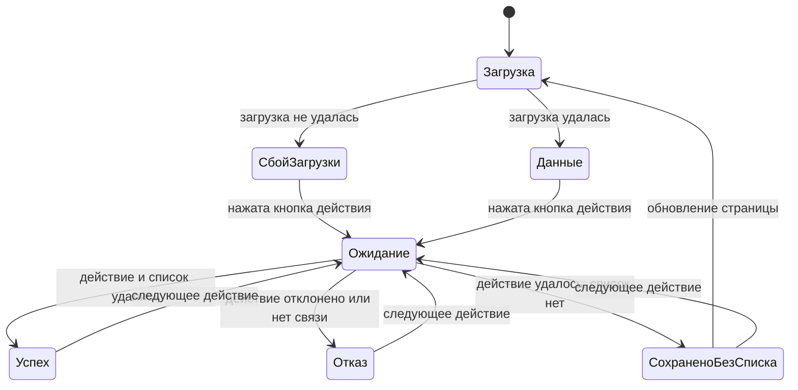

# UX-паттерны: экраны и переходы

Третья часть handoff-пакета ДЗ-3. Требования — в `prd.md`, критерии приёмки — в `user-stories.md`, решения D-01..D-09 —
в `06-CONTEXT.md` фазы 6, визуальные правила — в `DESIGN.md`.

Приложение остаётся одной страницей без маршрутизации. Поэтому «экран» здесь — это состояние страницы, а «переход» —
событие, которое её меняет.

## Раскладка

Порядок разделов — D-01. Форма выдачи стоит первой, поэтому отказ виден без прокрутки (S-2).

```text
Ширина от 768 px                              Уже 768 px

Библиотека                                    Библиотека
[ошибка загрузки, только при сбое]            [ошибка загрузки, только при сбое]

┌ Выдачи ─────────────────────────────────┐   ┌ Выдачи ─────────────┐
│ Книга [ ▾]         Читатель [ ▾]        │   │ Книга [ ▾]          │
│ Свободно: 1 из 2   На руках: 2  [Выдать]│   │ Свободно: 1 из 2    │
│ [итог формы выдачи]                     │   │ Читатель [ ▾]       │
│ [итог «Вернуть»]                        │   │ На руках: 2         │
│ Таблица выдач                           │   │ [Выдать]            │
└─────────────────────────────────────────┘   │ [итог формы выдачи] │
┌ Книги ─────────────┐ ┌ Читатели ──────────┐ │ [итог «Вернуть»]    │
│ Форма, [итог]      │ │ Форма, [итог]      │ │ Таблица ← прокрутка │
│ Таблица            │ │ Таблица            │ └─────────────────────┘
└────────────────────┘ └────────────────────┘ ┌ Книги ──────────────┐
                                              │ Форма, итог, таблица│
API: ok                                       └─────────────────────┘
                                              ┌ Читатели ───────────┐
                                              │ Форма, итог, таблица│
                                              └─────────────────────┘
                                              API: ok
```

Вкладок и скрытых форм нет: `tests/e2e/loans.spec.ts` заполняет формы подряд. Формы видны и активны во всех состояниях,
включая загрузку и сбой.

## Экраны

| ID  | Экран                | Условие                                 | Что видно                                                                                         | Требования       |
| --- | -------------------- | --------------------------------------- | ------------------------------------------------------------------------------------------------- | ---------------- |
| Э-1 | Загрузка             | Первая загрузка ещё идёт                | «Загрузка…» вместо каждой таблицы, текста о пустом списке нет                                     | FR-1, US-1       |
| Э-2 | Первый запуск        | Данные загружены, нет книг и читателей  | Тексты пустых списков, см. ниже                                                                   | FR-1, D-02, US-1 |
| Э-3 | Готово к выдаче      | Есть книги и читатели, выдач нет        | Таблицы книг и читателей, текст о пустом списке выдач                                             | FR-1             |
| Э-4 | Рабочий              | Есть выдачи                             | Таблицы; строки выдач в порядке FR-4, просроченные выделены; подсказки при выбранных полях        | FR-4, FR-6, US-5 |
| Э-5 | Сбой загрузки        | Первая загрузка не удалась              | Вверху причина с `role="alert"`, вместо таблиц «Данные не загружены», в подвале `API: недоступен` | FR-1, FR-2, US-1 |
| Э-6 | Ожидание ответа      | Запрос действия выполняется             | Кнопка действия заблокирована, её текст не меняется, старый итог ещё виден                        | FR-3, US-3       |
| Э-7 | Успех                | Действие и обновление списка удались    | Подтверждение с `role="status"`, таблицы обновлены                                                | FR-5, US-4       |
| Э-8 | Отказ                | Действие не выполнено                   | Причина с `role="alert"` в месте действия, данные формы сохранены                                 | FR-2, US-3       |
| Э-9 | Сохранено без списка | Действие удалось, обновление списка нет | «Сохранено, но список не обновился. Обновите страницу» с `role="status"`, таблицы прежние         | FR-5, US-4       |

Э-1..Э-5 описывают данные страницы, Э-6..Э-9 — ход действия. Они сочетаются: например, Э-4 и Э-8 при отказе выдачи.
Э-10, узкий экран, — та же страница в одну колонку, см. раздел «Клавиатура и узкий экран».

### Тексты пустых списков

Текст показывается только после успешной загрузки (FR-1) и заменяет таблицу.

| Раздел   | Условие                   | Текст                                                         |
| -------- | ------------------------- | ------------------------------------------------------------- |
| Книги    | Книг нет                  | «Каталог пуст. Добавьте первую книгу.»                        |
| Читатели | Читателей нет             | «Читателей пока нет. Добавьте первого читателя.»              |
| Выдачи   | Нет ни книг, ни читателей | «Чтобы выдать книгу, сначала добавьте книгу и читателя ниже.» |
| Выдачи   | Нет книг                  | «Чтобы выдать книгу, сначала добавьте её в каталог ниже.»     |
| Выдачи   | Нет читателей             | «Чтобы выдать книгу, сначала добавьте читателя ниже.»         |
| Выдачи   | Книги и читатели есть     | «Выдач пока нет. Выберите книгу и читателя выше.»             |

## Переходы



| Событие                       | Запрос                                | Что меняется на экране                                                          | Куда идёт фокус               |
| ----------------------------- | ------------------------------------- | ------------------------------------------------------------------------------- | ----------------------------- |
| Открытие страницы             | Здоровье API, книги, читатели, выдачи | Э-1, затем Э-2, Э-3, Э-4 или Э-5                                                | Не трогаем                    |
| Выбор книги или читателя      | Нет                                   | Подсказка FR-6 под полем                                                        | Остаётся в поле               |
| «Добавить», успех             | `POST`, затем обновление списка       | Форма очищена, строка в таблице, итог под кнопкой                               | В первое поле формы           |
| «Выдать», успех               | `POST /api/loans`, обновление списка  | Выбор сохранён, строка в таблице, срок в итоге, подсказки пересчитаны           | Возвращается на кнопку        |
| «Вернуть», успех              | `POST` возврата, обновление списка    | Строка уходит к возвращённым (FR-4), кнопки в ней нет, итог над таблицей (D-05) | На итог над таблицей          |
| Любое действие, отказ         | `POST`                                | Итог-ошибка на месте действия, поля и таблицы не меняются                       | Возвращается на кнопку        |
| Действие удалось, сбой списка | `POST` удался, обновление нет         | Э-9 на месте действия, форма очищена как при успехе, таблицы прежние            | Как при успехе этого действия |

## Правила итога действия

1. **Одно сообщение на страницу.** Новый итог заменяет предыдущий, где бы тот ни был. Поэтому на странице не бывает двух
   ошибок (FR-2), а строгая проверка `getByRole('alert')` в e2e остаётся верной.
2. **Место определяется действием.**

   | Действие                      | Где итог                               |
   | ----------------------------- | -------------------------------------- |
   | «Выдать»                      | Под кнопкой, в разделе «Выдачи» (D-03) |
   | «Вернуть»                     | Над таблицей выдач (D-05)              |
   | «Добавить» книгу или читателя | Под кнопкой формы, в её разделе (D-03) |
   | Начальная загрузка            | Вверху страницы (FR-2)                 |

3. **Итог живёт до следующего результата** (D-04). Таймеров нет. Пока идёт запрос, старый итог остаётся на месте, чтобы
   страница не прыгала. Ошибка начальной загрузки тоже заменяется итогом следующего действия.
4. **Роли не смешиваются.** `role="alert"` только у ошибок, `role="status"` только у подтверждений и Э-9. Подсказки FR-6
   и тексты пустых списков живых ролей не имеют.
5. **Сообщение должно быть видно.** Если итог оказался вне экрана, страница прокручивается к нему ровно настолько, чтобы он
   появился, и без анимации. D-05 требует этого для «Вернуть»; то же правило принято и для остальных итогов, потому что
   кнопка формы книг может стоять у нижнего края окна.

## Ожидание ответа (FR-3)

- Кнопка заблокирована до конца всего действия, **включая обновление списка**. Иначе между ответом и новой таблицей
  «Вернуть» можно нажать второй раз и получить «Книга уже возвращена».
- Блокируется только кнопка самого действия; у «Вернуть» — только в её строке. Остальные действия доступны.
- Текст кнопки не меняется: e2e ищет кнопки по именам «Добавить», «Выдать», «Вернуть».
- После ответа фокус возвращается по таблице переходов: браузер снимает его с заблокированной кнопки, и без этого
  пользователь клавиатуры окажется в начале страницы.
- Индикатор загрузки не нужен: запросы локальны. Optimistic UI не используем, см. раздел «Что не входит» в `prd.md`.

## Подсказки в форме выдачи (FR-6)

- Источник: `BookView.available` и `copies`; число активных выдач считается по `LoanView.readerId` и `returnedAt`.
- Пока поле не выбрано, подсказки нет, но строка под полем зарезервирована, чтобы кнопка и итог не сдвигались.
- Подсказка связана с полем через `aria-describedby` и лежит вне `<label>`: e2e ищет поля по подписям «Книга» и «Читатель».
- Текст вариантов в списке не меняется: e2e выбирает книгу по точному названию.
- Подсказка ничего не блокирует. При «Свободно: 0 из 1» кнопка доступна, отказ приходит от сервера.

## Тексты

Тексты ошибок берутся из `errorMessage` в `src/client/api.ts` без изменений. Новые тексты:

| Ситуация          | Текст                                                          |
| ----------------- | -------------------------------------------------------------- |
| Книга добавлена   | «Книга «Мастер и Маргарита» добавлена»                         |
| Читатель добавлен | «Читатель Анна Петрова добавлен»                               |
| Книга выдана      | «Выдано: «Мастер и Маргарита», Анна Петрова. Срок: 14.11.2026» |
| Книга возвращена  | «Принято: «Мастер и Маргарита», Анна Петрова»                  |
| Э-9               | «Сохранено, но список не обновился. Обновите страницу»         |

## Ошибки: где показывать

Дополняет таблицу из `user-stories.md`: там нет трёх кодов «не найдено» и внутренней ошибки, а место зависит от действия.

| Код или условие                                  | Текст из `errorMessage`               | Где                  |
| ------------------------------------------------ | ------------------------------------- | -------------------- |
| `NO_FREE_COPIES`, `LOAN_LIMIT_REACHED`           | Текст по коду                         | Под кнопкой «Выдать» |
| `BOOK_NOT_FOUND`, `READER_NOT_FOUND`             | Текст по коду                         | Под кнопкой «Выдать» |
| `LOAN_ALREADY_RETURNED`, `LOAN_NOT_FOUND`        | Текст по коду                         | Над таблицей выдач   |
| `VALIDATION_ERROR`, `INTERNAL_ERROR`, другой код | Текст по коду или «Ошибка сервера»    | Место действия       |
| Сбой сети при действии                           | «Сервер недоступен»                   | Место действия       |
| Сбой при начальной загрузке                      | «Сервер недоступен» или текст по коду | Вверху страницы      |

Пустые обязательные поля проверяет браузер (`required`), как и сейчас: запрос не уходит, итог не меняется.

## Клавиатура и узкий экран

- Порядок Tab совпадает с порядком на экране: форма выдачи, таблица, книги, читатели. Элементы управления не переставляются
  стилями, у всех виден фокус (NFR-2).
- После «Вернуть» кнопка исчезает вместе с фокусом, поэтому фокус переходит на итог (`tabindex="-1"`).
- **Узкий экран (Э-10).** Ниже 768 px одна колонка, поля на всю ширину. У страницы нет горизонтальной прокрутки на 360 px;
  широкая таблица прокручивается внутри своего блока, блок доступен с клавиатуры (NFR-1).

## Паттерны и откуда они

| Паттерн                                    | Откуда                            | Где применён    |
| ------------------------------------------ | --------------------------------- | --------------- |
| Главное действие первым                    | Libib                             | Раскладка       |
| Сообщение об ошибке рядом с действием      | Koha                              | Правила итога   |
| Пустой список подсказывает следующий шаг   | Koha, лекция 29.10 (основы UX)    | Э-2, Э-3        |
| Сроки: самое срочное сверху, строка цветом | Libib                             | Э-4             |
| Сведения до действия, но без запрета       | Libib; запрет отвергнут из-за e2e | Подсказки FR-6  |
| Блокировка кнопки на время запроса         | Защита от дублей, FR-3            | Ожидание ответа |

## Известные ограничения

- `API: ok` проверяется только при открытии страницы. Если сервер упадёт позже, подвал покажет старое значение, а причину
  сообщит итог действия. Индикатором текущего состояния он не считается; менять это в данном объёме не нужно.
- При нескольких действиях подряд итог показывает результат того, что закончилось последним. Для одного библиотекаря
  (A-1) и локальных запросов этого достаточно.
